# Model

https://sylwaltz.nl/

Het staat model voor digitale tuintjes welke bij 'Het web is voor iedereen' door studenten worden gemaakt.

### bronnen

- Stack Overflow: Als ik tegen een specifieke probleem aanloop, keek ik hier als iemand hetzelfde probleem had en als er oplossingen ervoor waren
- MDN Web Docs: Gebruikt voor uitleg over HTML en CSS
- Pinterest: Voor inspiratie
- Deep dives (en de videos/links daarin)
- ChatGPT als ik er echt niet uitkwam en bij debuggen

## Inhoudsopgave

## Learning Log

## Maandag 31 AUG - Sprint 0

Een fork gemaakt, domeinnaam aangemaakt en gepubliceerd met Github pages.

Een zelftest gemaakt om onze kwaliteiten beter te weten.
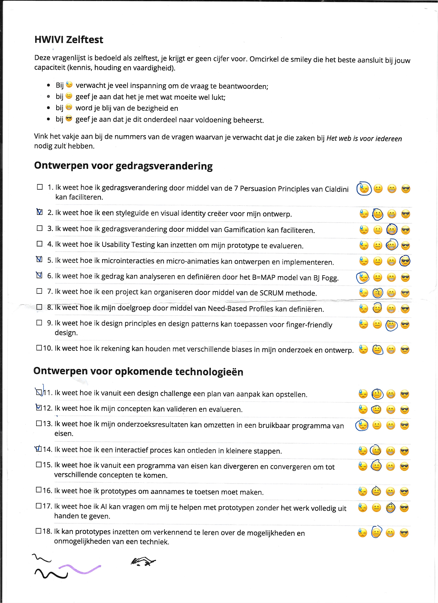
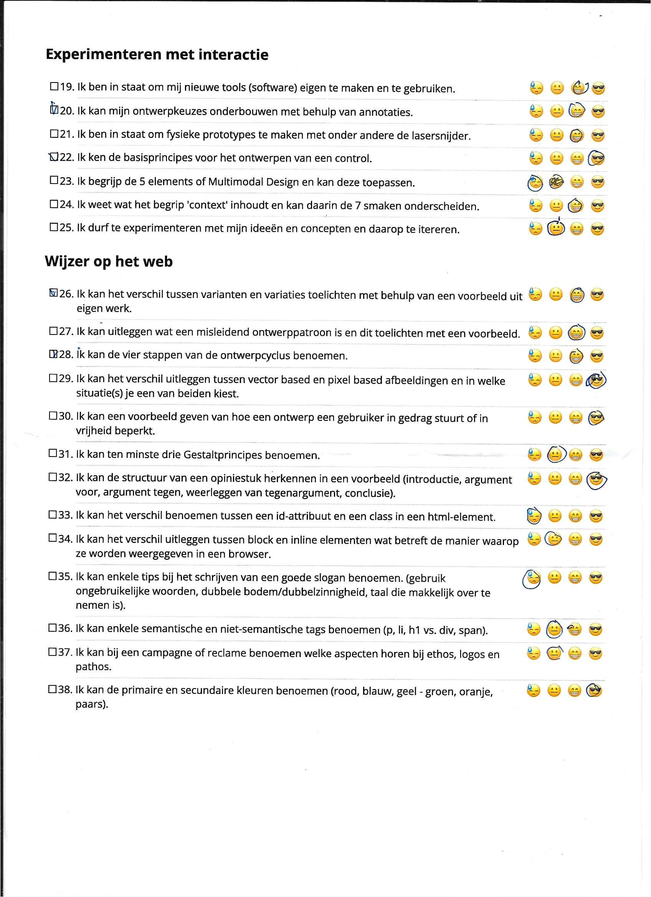

### CHECK-OUT

- Leg uit wat een source hosting platform is en voor welke jij gekozen hebt:
  Een source hosting platform is een online platform waar je code kan bewerken en opslaan en later op het web kan plaatsen.
- Vertel welke domeinnaam jij gekozen hebt en hoe je die hebt gekoppeld aan jouw pagina:
  Mijn domeinnaam is sylwaltz.nl deze heb ik gekoppeld door het in Github en daarna door Transip online op het web laten zetten.
- Beschrijf hoe je aanpassingen aan jouw pagina kunt maken en hoe je er voor zorgt dat die op het web gepubliceerd worden:
Je kunt aanpassingen maken in je document in bijv. VScodium, ze dan opslaan en dan een commit er van te maken. Github stuurt deze aanpassingen dan door naar de website.

## Woensdag 2 SEP - Sprint 1

De deepdives HTML & CSS Basics en CSS: fonts met kleur en effect gevolgd, kon geen screenshots hierbij vinden....

## Vrijdag 4 SEP - Sprint 1 (ziek thuis)

## Maandag 7 SEP - Sprint 1

In een groepje hebben we een artikel gelezen over wat een digital garden eigenlijk is en verschillende lees tactieken gebruikt om zoekend te lezen.

We kregen de opdracht om twee websites te analyseren en te kijken of ze 'webby' zijn.
De twee websites die ik ging analyseren was https://www.naiveweekly.com/ en https://www.webdesignmuseum.org/

Daarna moesten we in groepjes bespreken welke het minst en meest webby was. Wij kozen https://kwon.nyc/internet/ als minst en https://melonland.net/ als meest webby.

### CHECK-OUT

- Leg uit wat een digital garden is en waarom dat ander is dan een reguliere website:
  Digital garden zijn een persoonlijke verzameling van jouw interesses, ideeën en opinies. Deze websites zijn nooit af en worden altijd bijgewerkt door de maker.
- Leg uit wat een website ‘webby’ maakt en welke websites jou het meeste inspireren:
  Wat een website ‘webby’ maakt, is dat het interactief is (klikbare elementen), adaptieve lay-out en toegankelijk voor meeste gebruikers.
  inspiratie (https://ita.toys/, https://app.notion.com/p/digital-garden-202fbdf4ad4480538b87d2fcab8a5803, https://sortedsongs.com/)
- Vertel waar jij mee aan de slag wilt gaan bij het maken van jouw eigen digital garden:
Ik wil graag iets doen met animaties en dingen interactief maken

## Dinsdag 8 SEP - Sprint 1

We moesten een HTML presentatie maken met remark over een onderwerp voor je Digital garden. Hierbij moest je ook 50 afbeeldingen verzamlen, 10 linkjes en een introtekst verzinnen.

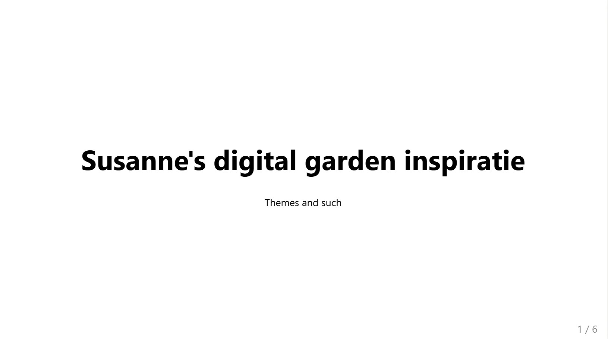
.jpg>)
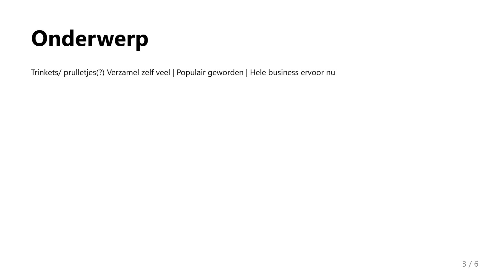
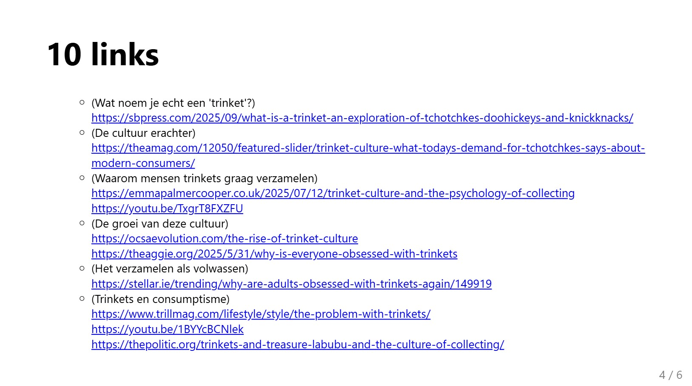
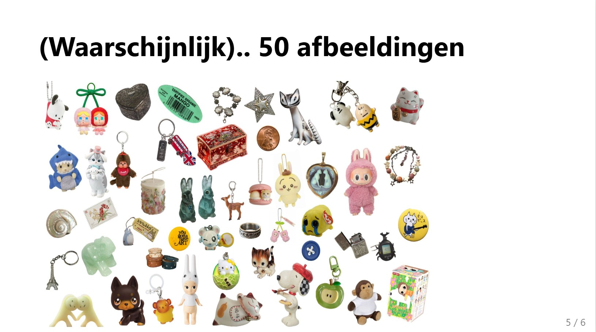
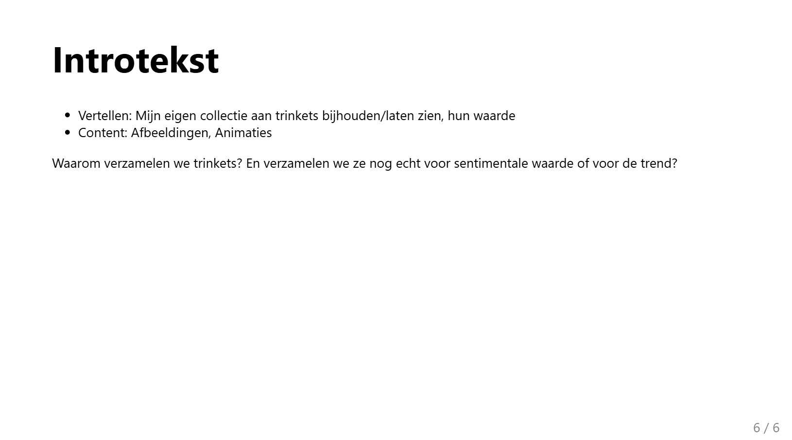

Mijn onderwerp zijn trinkets maar ik weet nog niet helemaal in welke richting ik het wil vertellen.

## Woensdag 9 SEP - Sprint 1 (Online)

We moesten online onze onderwerp presenteren met een medestudent, hierbij hadden we ook wat vragen beantwoord:

- Wat is voor jou de essentie van wat je hebt gepresenteerd qua onderwerp en geschreven/beeldende content?
  De essentie voor mij is eigenlijk het verzamelen en wat het nou betekent. Heeft het verzamelen nog waarde en vallen we niet victim aan consumptie?
- Welke woorden uit de kwaliteitenlijst kunnen passen bij je onderwerp? Subcultuur?
  Jongeren? We wisten het niet helemaal
- Wat is het karakter/ de uitstraling/ het gevoel dat bij het onderwerp past? (bijv. stoer, hip, vrolijk, dynamisch, eenvoudig, enz.)
  Ik wil het een speelse vibe geven maar de content erin wat nostalgisch/ sentimenteel

Daarna begonnen we met een visual research te doen waar ik koos voor de sfeerwoord: sentimenteel, iets wat ik passend vond voor mijn trinkets omdat het vaak gaat over herinnnerigen en het objectje. Nadat ik het sfeerwoord had gekozen moest ik inspiratie vinden door afbeeldingen en posters te verzamelen waarnaar ik 4 posters moest kiezen als inspiratie voor ideeën met crazy 8's.
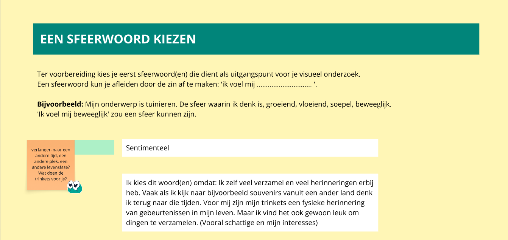
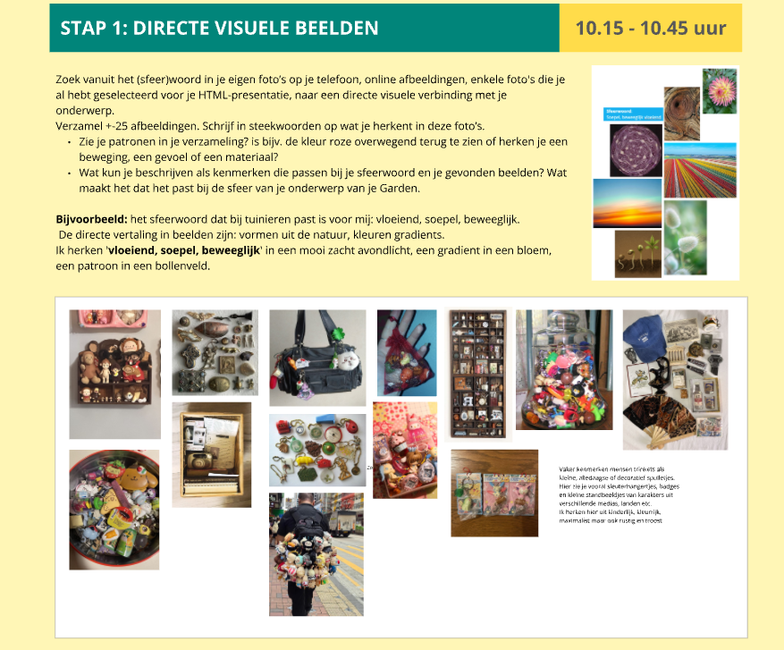
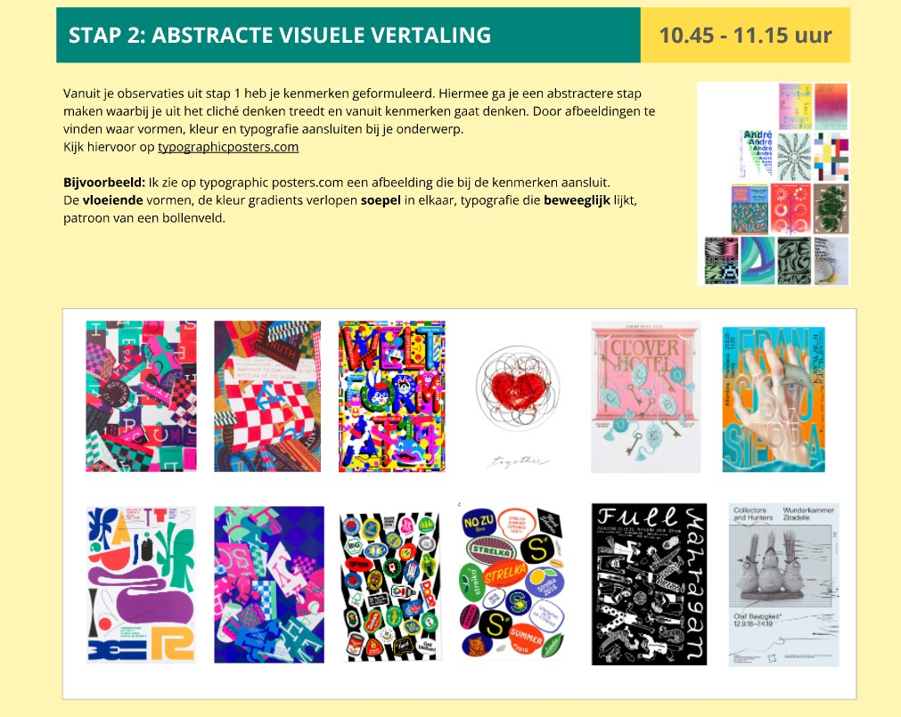
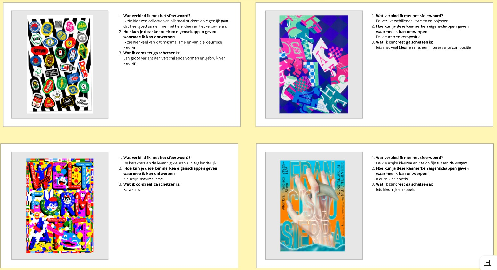
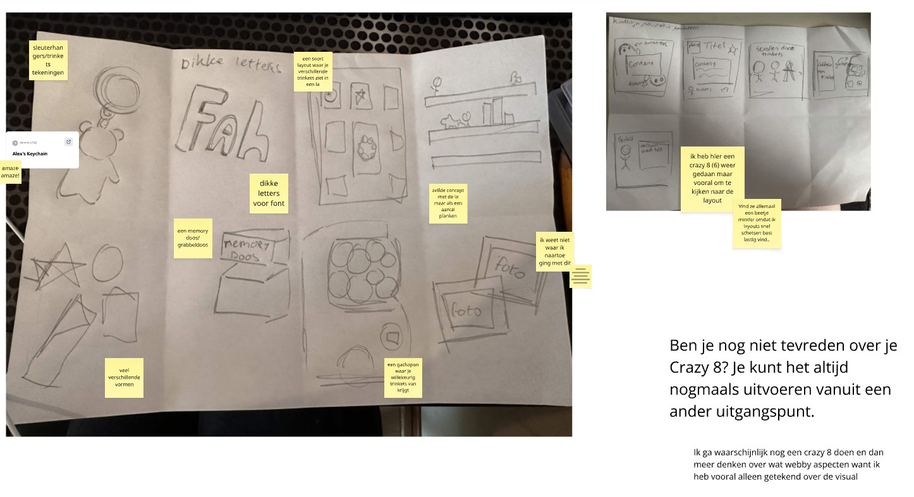
Ik had na mijn crazy 8's nog 5 extra ideeën bedacht, qua hoe de layout eruit zou zien. Maar ik vond ze wat minder doordat ik layouts in een minuut bedenken wel lastig vind.
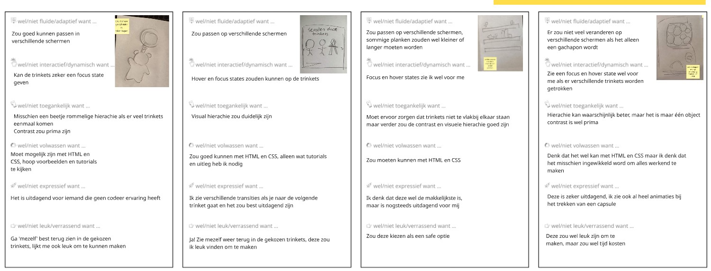
Heb alleen 4 beoordeeld omdat ik de rest gewoon niet heel interessant vond en niks veel kon over zeggen.

Als huiswerk kregen we de opdracht om je beste ideeën te schetsen in mobile schermen.

### CHECK-OUT

- Leg uit waar het Visual Research in 3 stappen naartoe werkt:
  Het Visual Research helpt je van je sfeerwoord een concreet beeld te krijgen van je thema en hoe je dat wilt visualiseren.
- Vertel in 2 zinnen waar jouw Garden over gaat, en met welke content je dat gaat doen (beeld, tekst, sound, animatie enz):
  Ik wil mijn Garden maken over trinkets/charms die ik over tijd heb verzameld. Hier wil ik graag veel van de afbeeldingen zelf tekenen (zoals de trinkets), fotos van de voorwerpen zelf en het liefst weinig tekst.
- Vertel kort welk idee van de Crazy 8 je het liefst zou willen uitvoeren/ verder zou willen onderzoeken:
  Ik zou graag de sleutelhanger of gachapon idee uitvoeren/ verder willen onderzoeken.

## Vrijdag 11 SEP - Sprint 1

### CHECK-OUT

- Welke feedback heb je gehad?:  
 Ik kreeg vandaag niet per se heel veel feedback maar ik kreeg wel te horen dat mijn Gachapon idee het interessante was uit mijn vijf schetsen, dus ga ik daar verder mee.

## Maandag 14 SEP - Sprint 1

### Bi-Weekly Geek

We hebben de Bi-weekly Geek gedaan waar we eerst vragen gingen beantwoorden in Wooclap. De vragen ging o.a over wat we beschouwen als de Internet en hoe men er mee omgaat. Daarna, in een groepje, hadden we een aantal vragen beantwoord over het onderwerp.

.jpg>)
Eerste deel waar mijn groepje de vragen bedacht:
.jpg>)
Tweede deel waar mijn groepje de vragen van een andere groepje beantwoordde

### Deep-dive

Had de deepdive Responesive grid + Grid area gevolgt op school, hoewel het niet handig was deze te volgen zonder de andere grid deepdive te volgen. Maar heb wel veel geleerd over het responsive maken van een website met grids.
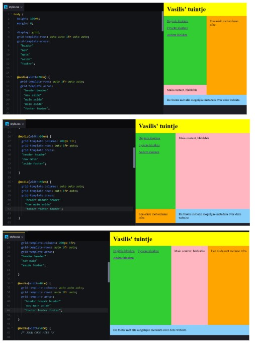

### CHECK-OUT

- Leg uit wanneer een website 'lelijk' wordt en geef voorbeelden wat je kan doen om deze 'lelijke' onderdelen te fixen?
  Het wordt 'lelijk' als de website niet meer goed werkt en als de leesbaarheid en toegangelijkheid tegenvallen. Lelijke onderdelen kan je fixen door je code te checken met de inspect functie.
- Vertel welke volgende stap je neemt om je website responsive te maken.
  Gebruik maken van media queries.
- Kun je het ontwerp en de bouw van je eigen Garden (zo uit je hoofd) onderbouwen in Webby vocabulair?
  Ik zou dat nu nog niet kunnen, weet de termen nog niet helemaal uit mijn hoofd.

## Woensdag 16 SEP - Sprint 1

Links bovenin heb ik mijn gachapon idee geschets in mobile scherm, daarna werd deze doorgegeven in een groepje en daarop feedback gegeven. Ik vroeg mijn groepje vooral te letten op de layout en als ze daar aanpassingen konden maken.

Had nog ook een digital opmaak gemaakt in Figma om voor mezelf een betere visie te hebben.
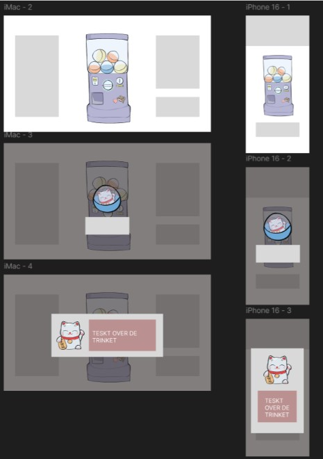

### CHECK-OUT

- Noem 3 Gestalt- of Design principes op en laat de ander uitleggen wat ze betekenen en doen.
  Balans - Aan beide kanten een gelijke visueel ontwerp
  Schaal - Grootte van een element in verhouding tot een ander element
  Hierachie - Elementen rangschikken in volgorde van belangrijkste tot minder belangrijk
- Een grid biedt ruimte om te spelen (vrijheid), maar tegelijkertijd ook eenheid en structuur (vastigheid). Wat wordt hiermee bedoeld?
  Je kan zoveel columns en rows toevoegen maar de lijnen bij een grid geven ook structuur.
- Welk principe neem je mee in een laatste iteratie van je eigen Garden?
  Ik denk dat ik goed nog moet kijken naar schaal van elementen en afbeeldingen.

## Donderdag 16 SEP - Sprint 1

Ik was niet blij met hoe mijn gachapon eruit ziet omdat hij er wobbelig en geen structuur heeft. De gachapon's kleuren heb ik ook veranderd naar wat doffe kleuren omdat het meer van dat sentimentele gevoel zou geven. Zovan dat de gachapon wat verouderd is en de trinkets daar binnen mijn 'memories'.

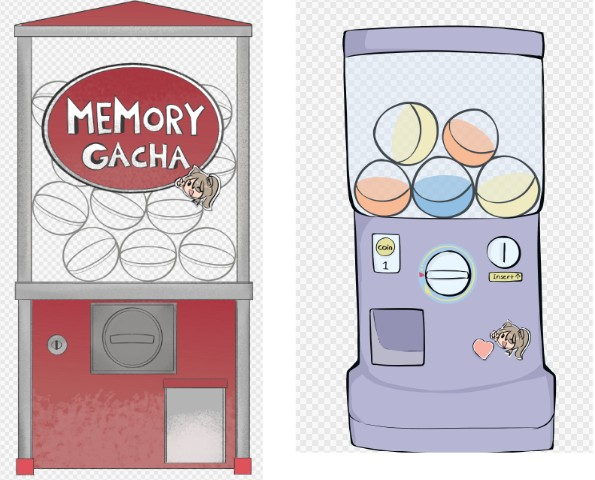

## Vrijdag 18 SEP - Sprint 1

### Retrospective

We begonnen eerst met het rangschikken van verschillende Sketchnotes, daarna gingen we indivueel bezig met het tekenen van de retrospective.
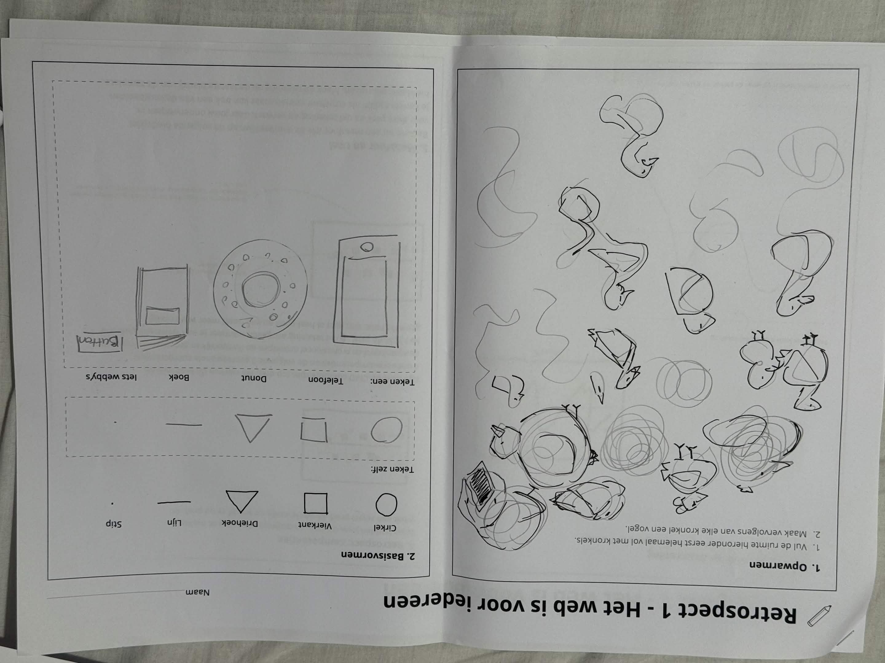
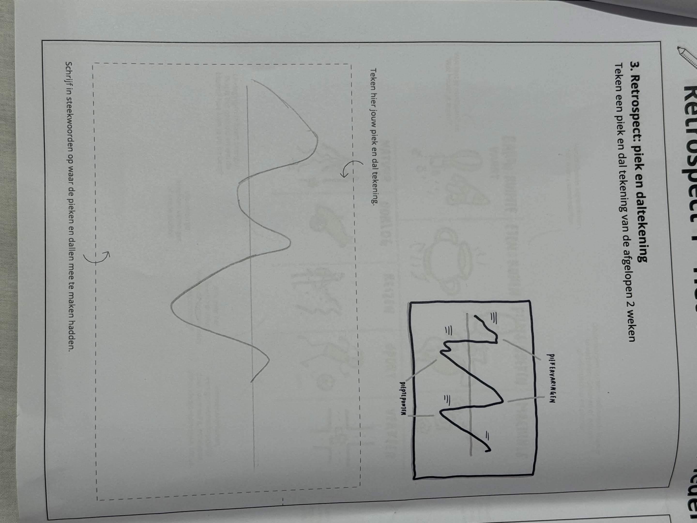
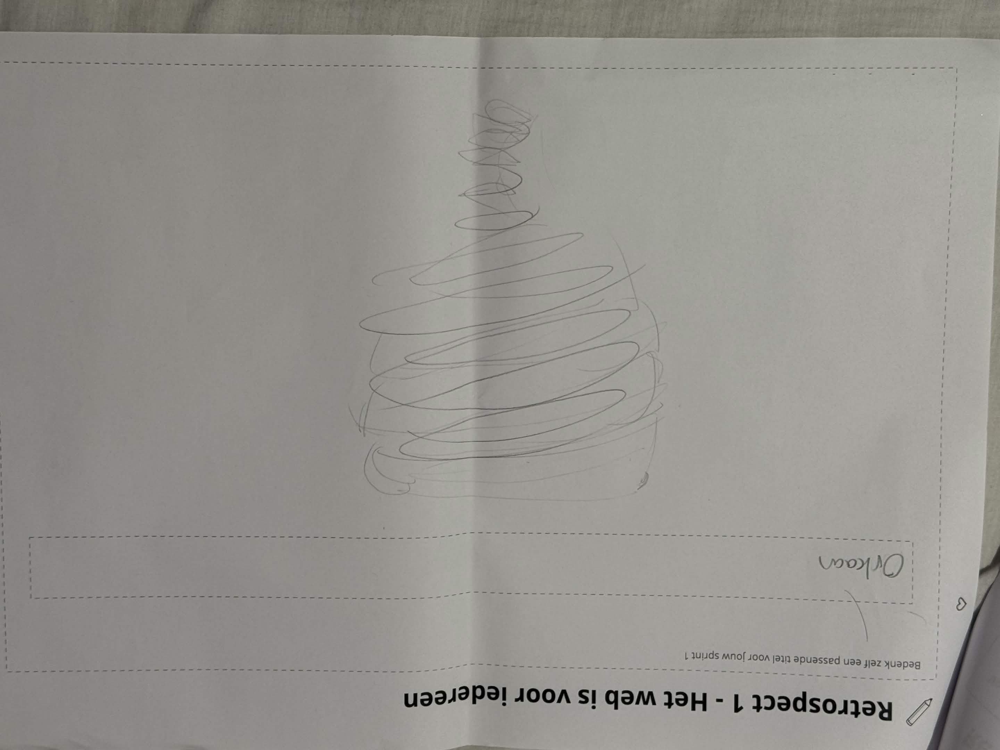

### Feedback

Ik kreeg niet heel feedback omdat veel van de tijd gebruikt werd om mijn website nog in te leveren omdat het niet gekoppeled was naar mijn Github. De light en dark mode werkte ook niet, dus dat moet nog gefixt worden. Het idee was goed, maar moet gewoon verder werken.

De website op dat moment:
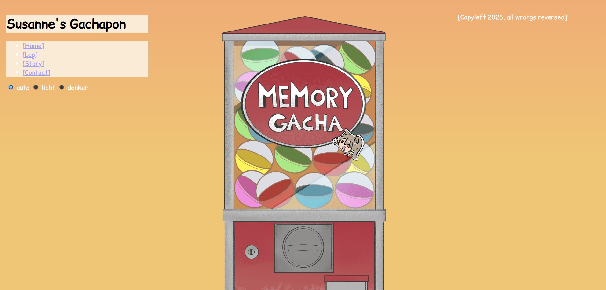
.jpg>)
.jpg>)

## Maandag 21 SEP - Sprint 2

In een duo gingen we kijken naar verschillende websites en hun cookie vermeldingen. We kwamen erachter dat Paradiso niet goed aangeeft wat er met persoonlijke data gedaan wordt.

.jpg>)

### CHECK-OUT

- Wat zijn HTML landmark role elements?
  Deze elementen worden gebruikt om belangrijke secties van een webpagina aan te geven, hierdoor kunnen schermlezers en andere hulpmiddelen makkelijker door de inhoud navigeren.
- Wat zijn heading elementen en hoe horen deze 'genest' te worden?
  Heading elementen zijn semantiek tags die gebruikt worden om hoofdtitels en ondertitels te defineren. Ze horen genest te worden in de volgorde van h1-h6.
- Hoe ga jij met cookies om> Beschrijf jouw beweegredenen en of die zijn veranderd na het volgen van dit college.
Als ik cookies tegenkom weiger ik ze meteen, of als ik de optie krijg, check ik alle preference boxes uit.

## Dinsdag 22 SEP - Sprint 2

Deep dive - Buttons, states, selectors gedaan:

.png>)
.png>)

## Woensdag 23 SEP - Sprint 2

In de les bezig geweest met dark patterns en het implenteren van een cookie melding.
Vragen: 
- Bespreek in jouw groepje welke gegevens op jouw digital garden van gebruikers verwerkt worden. Houdt daarbij in de gaten welke diensten je allemaal gebruikt. Zelfs als je alles zelf geschreven hebt zijn dat er al twee: GitHub pages hosting én het digitaaltuintje component.
  Ik gebruik voor mijn website alleen Github pages en het digitaaltuintje.
- Informeren van gebruikers is een plicht die je hebt als websitemaker: Hoe kan je gebruikers informeren over het gebruik van hun gegevens op jouw website?
  De gebruiker een pop up geven wanneer ze website bezoeken dat meteen uitlegt wat er met hun data gebeurt en hun ook de optie geven als ze willen weigeren enzo.
- Op welke manier kan je instemming vragen? Doe desk-research en zoek tenminste 10 verschillende manieren van het vragen van consent op het web.
  Het checken van preference boxen
  De website alleen mogen gebruiken als ze akkoord zijn met het privacybeleid
  Sommige functies uitschakelen als ze er niet akkoord mee zijn
- Denk na over een manier van werken die past binnen de layout van jouw digital garden? 
  Misschieen een cookie trinket die van het scherm hangt als een sleutelhanger of in de eerste capsule die je trekt krijg je de cookie pop up

### CHECK-OUT

- Wat is een wireflow en wat heb je er aan?
  Een wireflow laat het proces zien van hoe een gebruiker van scherm naar scherm moet en dus de flow laat zien. Het is heel handig om te zien hoe de schermen met connecten en werken
- Wat zijn dark UX patterns? Geef drie voorbeelden
  Een dark UX patterns zijn patronen in een digital product dat gebruikers manipuleert of misleid.
  - Nagging
  - Fake social proof
  - Hidden costs
- Waar moet je als ontwerper rekening mee houden bij het maken van een human consent component?
Als ontwerper moet je duidelijk vertellen aan de gebruiker wat er gebeurt met hun data. Dus je moet transparant zijn. Je moet ze ook de optie geven om te weigeren of gebruik te maken van check boxes/ preferences.

## Donderdag 24 SEP - Sprint 2

Deepdive buttons + Dialog

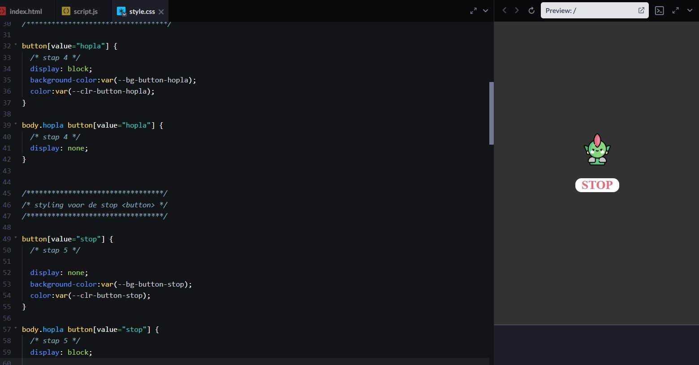
.jpg>)

## Vrijdag 25 SEP - Sprint 2

### CHECK-OUT

- Wat is HTML validatie, waarom is het belangrijk en hoe heb je dat vandaag uitgevoerd?
  Deze validator valideert je HTML om te kijken als alles semantisch klopt. Goede HTML is de base voor een goede toegangelijk website. Ik had deze gedaan door mijn VSC mapje (omdat ik nog lokaal werk) in de W3C site te zetten.
- Welke dingen vielen je op
  Ik had geen errors
- Welke feedback heb je ontvangen tijdens het gesprek met je docenten?
  Ik kreeg als feedback vooral te kijken naar mijn layout, font, de navigatie en webring gewoon helemaal weg te halen omdat ik daar toch niks mee ga doen.

  De website toen:

  .jpg>)
  .jpg>)

## Maandag 28 SEP - Sprint 2

Ik ben bezig geweest met het bedenken van mijn light en dark mode. Ik had gekozen om mijn eigen karakters te veranderen in kleine sleutelhangers die de maan(dark) en zon(light) vasthouden. Ik koose voor sleutelhangers omdat ik ze dan van de scherm kon laten 'hangen' en omdat ik zelf veel sleutelhangers verzamel en past ook bij mijn trinkets idee.

.png>)
.png>)
.png>)
Moet ze alleen nog toevoegen in mijn website.

### Bi-Weekly Geek

Deze weekly geek ging over AI en valse informatie. Alweer deden we eerst een vragenlijst in Wooclap en gingen daarna op papier vragen bedenken en beantwoorden van anderen.

.jpg>)
.jpg>)

### CHECK-OUT

- Wat bedoelt Vasilis met de uitspraak: Semantiek doet mij niet zo veel, ik ben liever bezig met de UX van HTML?
  De code hoeft niet helemaal correct te zijn maar de code moet wel toegankelijk zijn voor de gebruiker.
- Wat voor type beperkingen hebben invloed op het gebruiken van websites?
  - Visueel
  - Motoriek
  - Cognitieve
  - Geluid
- Noem drie manieren om door een website te navigeren met jouw screenreader.
  - Tab
  - Shift + Tab
  - Pijlen

## Woesndag 30 SEP - Sprint 2

We hebben onze website gecheckt of ze voldoen aan de WCAG checklist. Mijn website had niet veel content en dus was checken een beetje ehh.. Ik besefte hier wel dat ik veel nog moest doen.

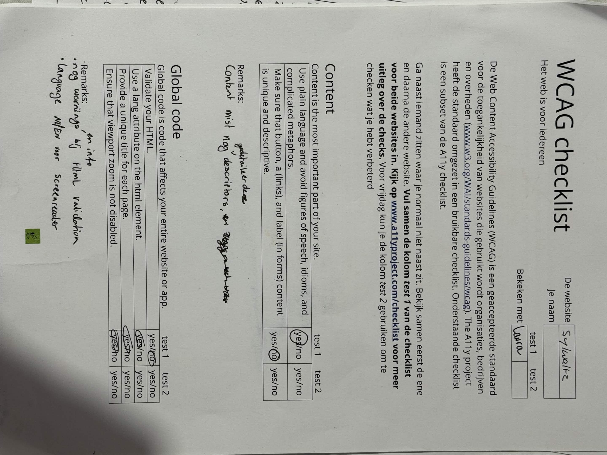
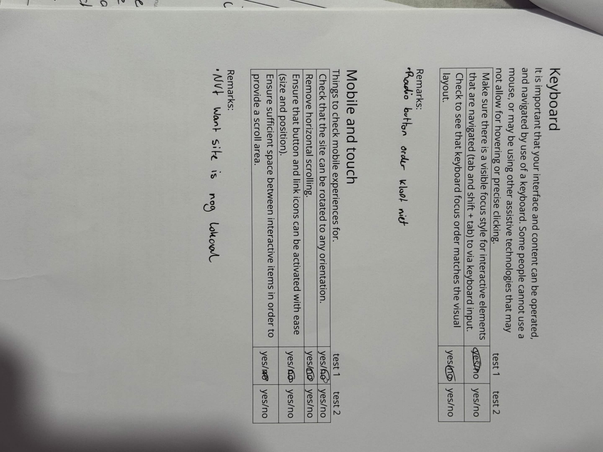
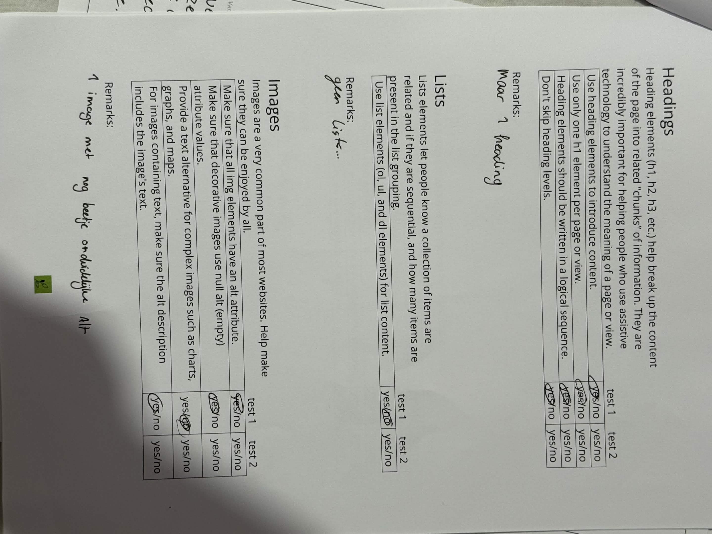
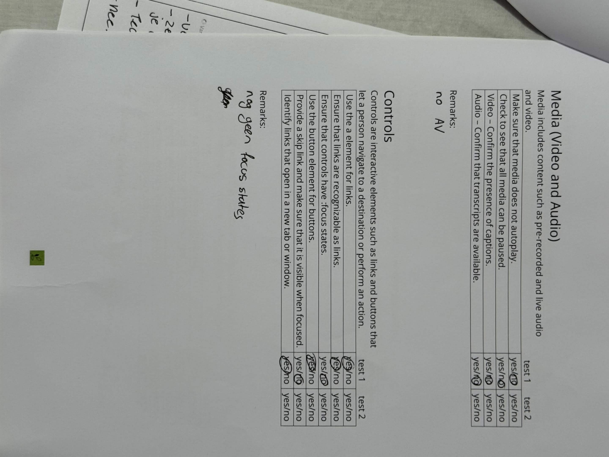
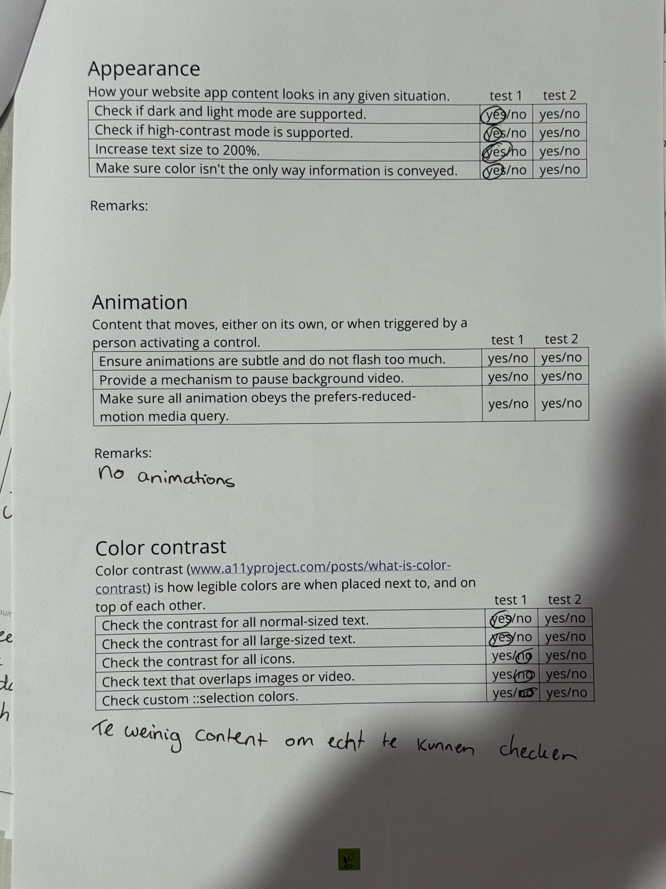

Ook kwam ik erachter dat veel van mijn images nog alt teksten miste en dat de screenreader in het nederlands praat terwijl mijn tekst in het engels is, dus klinkt het wat raar.

### CHECK-OUT

Waar staat WCAG en A11y voor?:

- WCAG staat voor de Web Content Accessibility Guidelines, dit is een checklist waar de geaccepteerde standaarden van toegangelijkheid worden gecheckt
  Wat vind je lastiger, je laptop/websites met een alleen een toetsenbord bedienen of met een screenreader?
  Waarom? Waar moet je nog mee oefenen?
- Ik vind het nog best moeilijk met alleen een toetsenbord een website te bedienen. Het komt vooral omdat ik veel shortcuts moet herinneren om de site te bedienen.
  Met welke beperking rekening houden vind je het meest lastig? Vind je dat je beperkt wordt in wat je kunt ontwerpen? Of heb je al manieren gevonden
- Ik ben nog niet bewust bezig geweest met een beperking, dus ik voel me nog niet heel gelimiteerd. Maar ik denk dat ik wel moeite ga hebben met cognitief

### Donderdag 1 OKT - Sprint 2

Ik begon te kijken hoe ik de layout van mijn website kon veranderen en hoe ik de trinkets ergens kan opslaan waardoor je op elke moment de trinket kan bekijken en daarbij een herinneringen erbij.

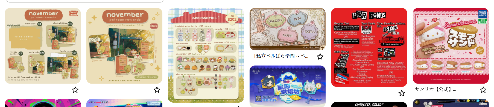
Hier had ik een pinterest bord gemaakt om inspiratie op te doen en wat voorbeelden te vinden van leuke layouts.
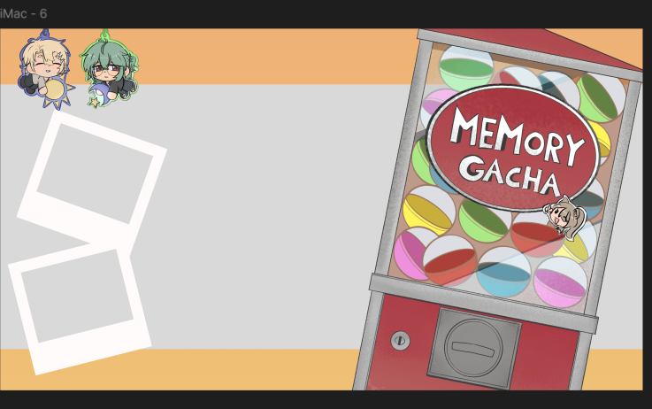
.png>)
.png>)
Uiteindelijk kwam ik op het idee om een cork bord te plaatsen waar polaroid fotos opgehangen zijn en de foto een herinnering enz. En als je er op klinkt krijg je trinket te zien waarmee ik die herinneringen mee verbind. Ik dacht dat dit goed zou laten zien waarom de trinkets een waardevol betekenis voor me hebben.

## Vrijdag 2 OKT - Sprint 2

### Retrospective

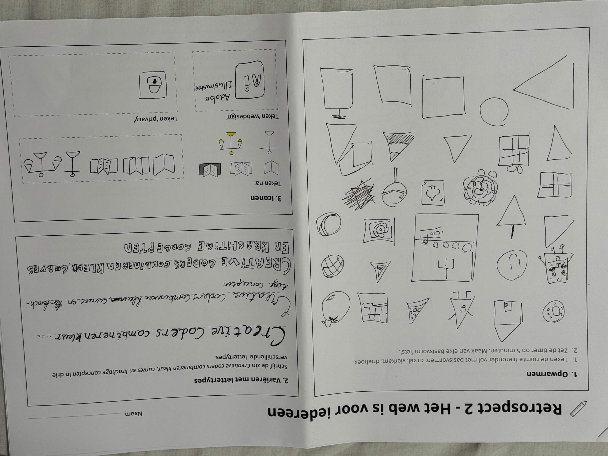
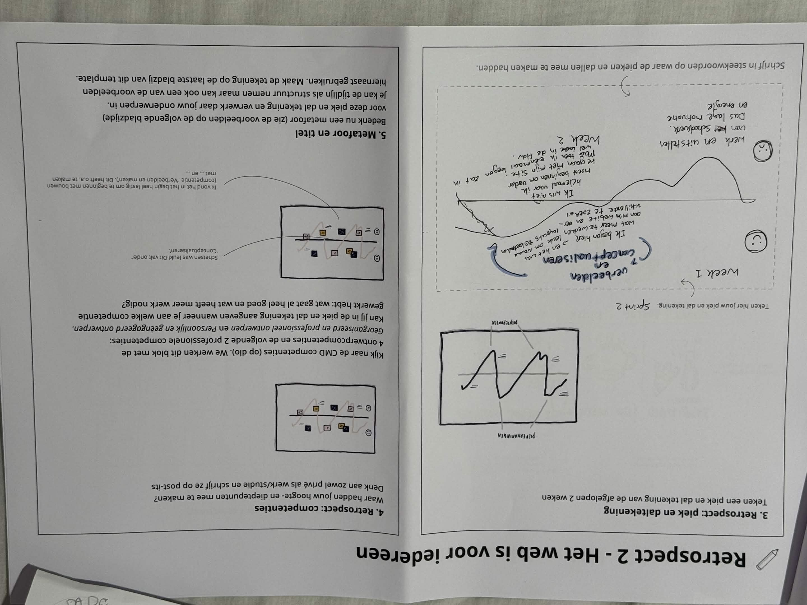
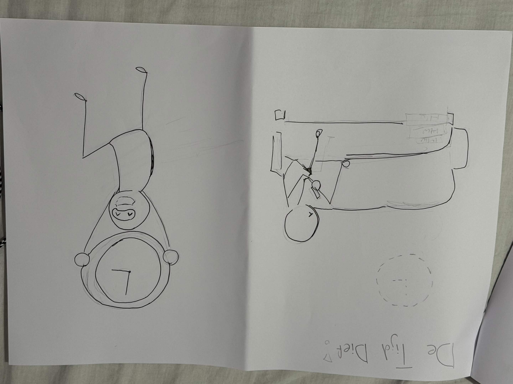

Daarna ging ik op gesprek met Sanne en kreeg ik ook feedback:

- Een favicon toevoegen
- Alles van de eerdere sprints inhalen
- Project klein houden
- Font matchen met de getekende font op de gachapon
- Header weghalen
- Geen cork bord maar trinkets laten floaten of ergens hangen
  .jpg>)
  .png>)
  .jpg>)
  Eigenlijk wist ik al dat mijn website veel dingen miste maar ik schrok wel toen ik al de onvoldoendes zag. Ik heb toen meteen het cork board idee geschrapt en besloten om het simpel te houden aangezien ik nog achterliep.

o.a had ik nog een codepen gekregen van Sanne die me zou helpen de gachapon werkend te maken met animaties: https://codepen.io/editor/shooft/pen/01a0fc77-5d44-7507-a57e-36a2e2091296

Website op dat moment:
.png>)
.jpg>)
.jpg>)
.jpg>)

## Maandag 5 OKT - Sprint 3

- Leg uit wat er met de volgende termen bedoeld wordt: kerning, tracking, leading, flush-left, flush-right, centered, justified, indent, outdent, modular scale, movable type, focus punt, vijf soorten contrast, spatial tension. (Hint, alle termen staan in de artikelen die we samen gelezen hebben)
  Dit zijn allemaal tyopgrafische termen die ervoor zorgen dat jouw typografie er goed uitziet en harmonie en betekenis aangeeft.
- Wat is jouw ideale regellengte (measure)? Leg uit waarom.
  Ik zou zeggen ergens van 50 tot 60 zou mijn ideale regel lengte zijn. Het is goed leesbaar en werkt ook goed op kleine schermen
- Als je in een ontwerp maar één variabele tot je beschikking had om hiërarchie aan te brengen (grootte, plaatsing, spacing, lettersoorten), welke zou je dan gebruiken en waarom?
  Ik denk dat ik plaatsing zou kiezen omdat daar veel mee gespeeld kan worden. Vooral als het gaat om hierachie kan plaatsing veel doen om de kijker's aandacht ergens te brengen.

## Woensdag 7 OKT - Sprint 3

Deepdive Variable fonts

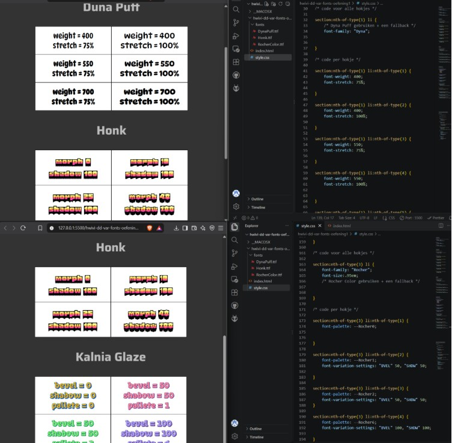

Ik had gekozen voor het lied: Voor ik vergeet van Spinvis. Hierbij had ik ook een aantal schetsen gemaakt.

### CHECK-OUT

- Waarom is het goed om een grid in je ontwerp toe te passen? Noem een reden voor de ontwerper en een voor de bezoeker.
  Een grid is handig om toepassen als ontwerper omdat dit structuur geeft
- Noem drie manieren om chaos in je ontwerp te voorkomen.
  Een vaste line-heights en font sizes, grids
- Hoeveel gekkigheid moet er in je werk zitten?
  Bomvol

## Vrijdag 9 OKT - Sprint 3

### Feedback songtekst

- Gevoel van liedje is niet passend, wat zachter maken
- Deepdives doen om technisch te helpen
- Wat meer ruimte tussen woorden en regels

### CHECK-OUT

- Welke variabelen van Seraphs gebruik je in de opmaak van je songtekst?
  nog niet gebruikt, maar ga het nog doen
- Wat voegt iedere variabele toe aan je ontwerp (denk aan leesbaarheid, hiërarchie of de uitstraling die je wil bereiken)?
  Het zou zeker de uitstraling van mijn ontwerp verbeteren
- Hoe zou je animatie kunnen toepassen om het ritme of de accenten in de weergave van je songtekst nog beter visueel te maken?
  De opacity van de tekst zou ik kunnen veranderen met een animatie zodat het lijkt dat het vervaagt

## Herfstreces

Van een non-cmder kreeg ik ook feedback. Zij zei dat de kleuren tot nu toe helemaal niet goed bij elkaar passen en dat de gachapon's kleuren best dof zijn en niet uitspringt van de achtergrond. Ik kwam hierbij als oplossing om dan de gachapon lichter te maken.
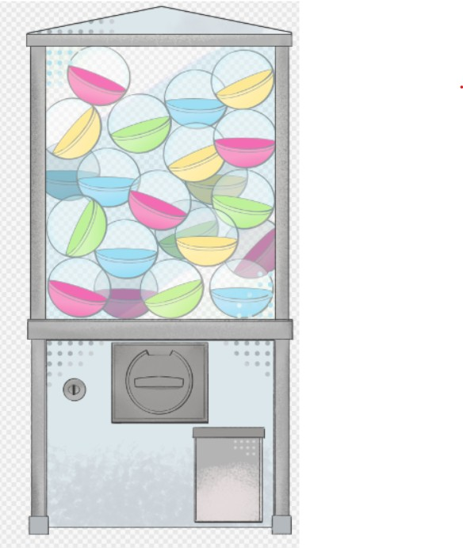

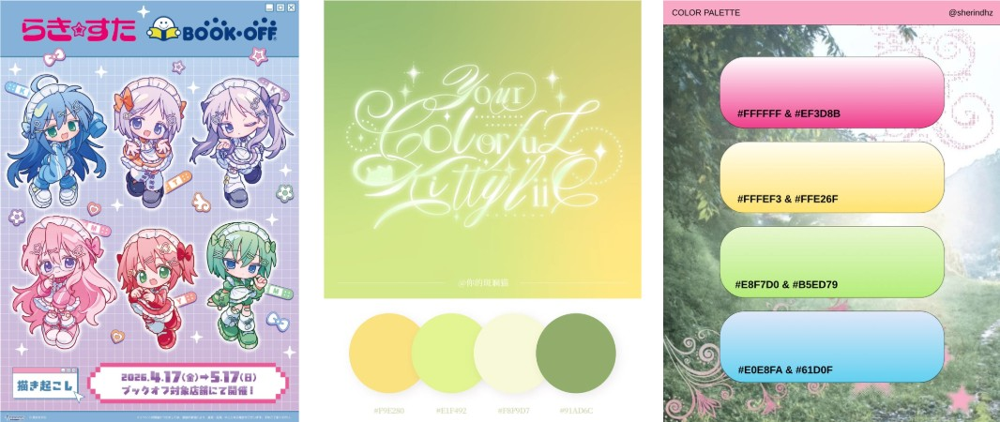
Afbeeldingen van pinterest die ik gebruikte als inspo voor het kleuren palette en achtergrond (gradient grid)
Ook kreeg ik te horen dat de karakters bij mijn light en dark mode in context een beetje out of place staan een geen echte waarde geven. Ik besloot hierdoor de trinkets in mijn gachapon toen te veranderen en dat zij de vorm namen van mijn karakters. Hierbij liet eigenlijk los van het sentimentele aspect van mijn concept en ging het nu vooral over mijn collectie. Wat ik eigenlijk passender vind voor mezelf.

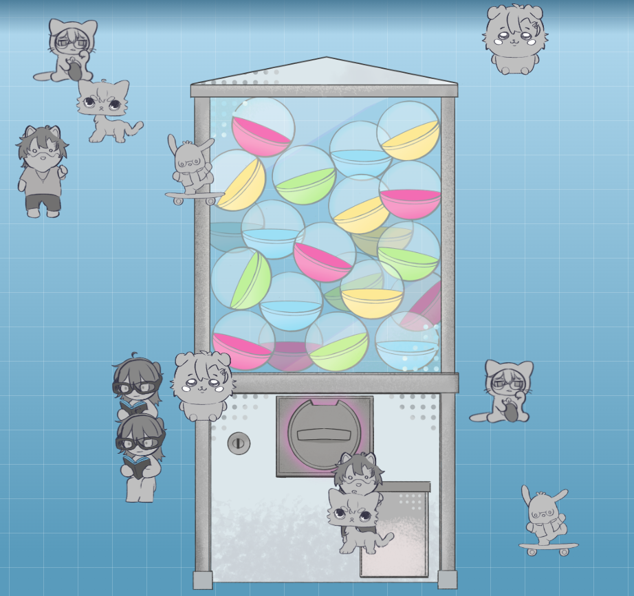
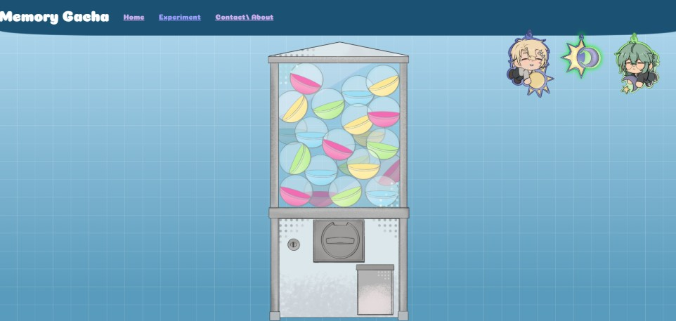
Hoe mijn website eruit zag na de herfst reces

## Maandag 19 OKT - Sprint 3

Samen met een medestudent gingen we kijken hoe webby onze websites waren met een webby formulier

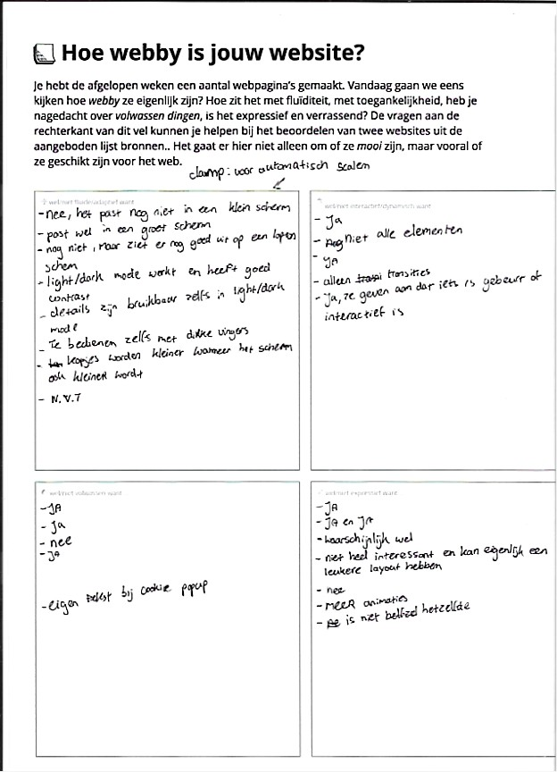

Het kwam er vooral op neer dat nog heel vinden niet werkte, zoals de gachapon button en de responsiveness. Dus moet ik nog veel doen.

## Woensdag 21 OKT - Sprint 3

### Bi-Weekly Geek

Bij deze weekly geek moesten we de vraag verzinnen en zelf ook gaan beantwoorden met de voorgestelde onderzoekmethodes.
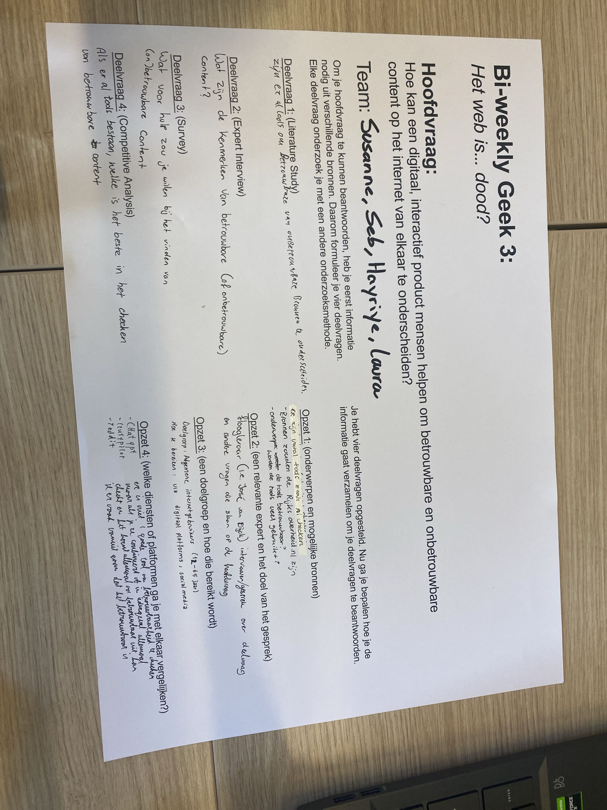

### Peerfeedback

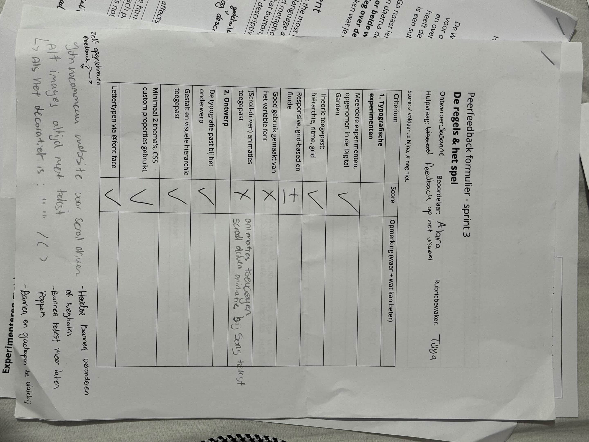
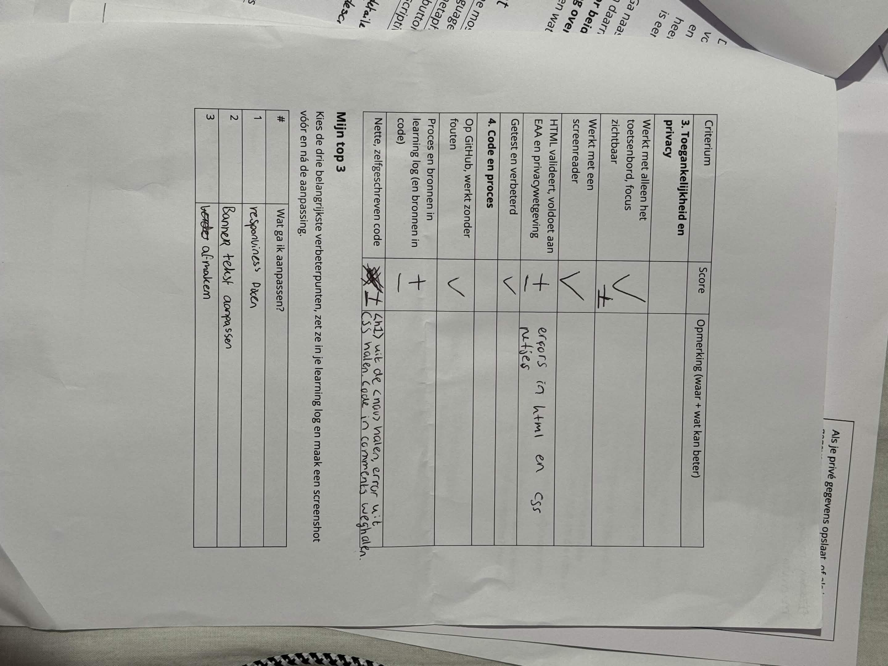
Bij de peerfeedback was het weer vooral: ik moet verder werken en dingen afmaken. Verder werd er gezegd om de banner weg te halen of te veranderen, de font van de titel veranderen naar iets meer pakkend en de responsiveness nog aanpassen.

### Deepdive

Ik heb de deepdive debuggen en verrijkken gevolgd waarbij Sanne mij heeft geholpen met de capsule animatie.

## Vrijdag 23 OKT - Sprint 3

### Retrospective

Met alle sprints samen zag ik mezelf als een schildpad in een race. Hoewel mijn werktempo best sloom was, door verder te werken en niet op te geven kan ik de finish lijn zijn.
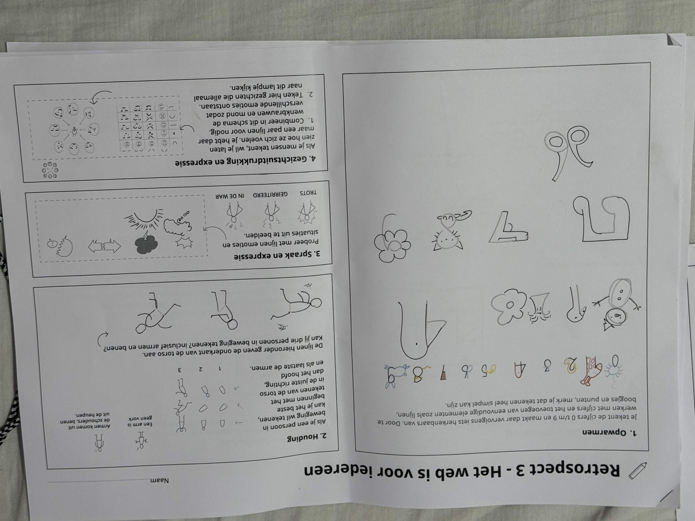
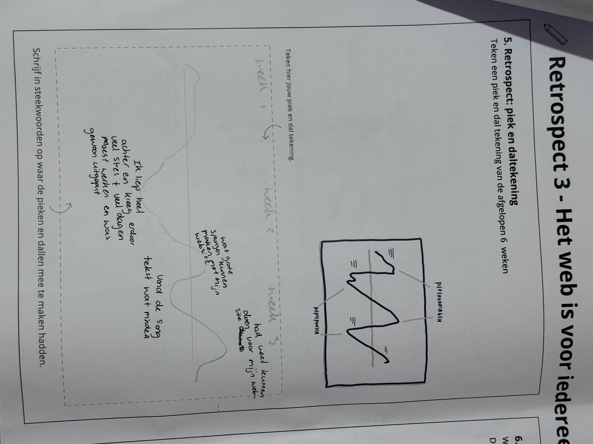

### Feedback

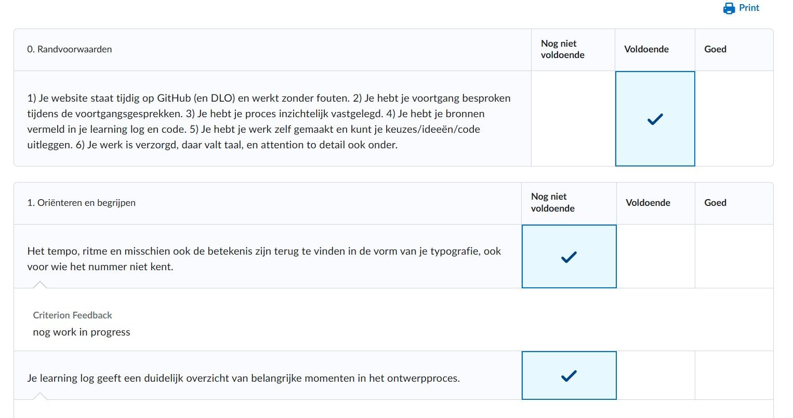
.jpg>)
.jpg>)
.jpg>)

nog paar dingen missen en er moeten nog wat dingen gefixt worden. Mijn songtekst is nog best weinig en niks speciaals omdat ik vooral me focus had gelegd op mijn website.

## Maandag 26 OKT - EXPO

Bij de Expo hebben we elkaars werk bekeken en feedback gegeven op 3 verschillende categories. Ik heb in het algemeen best veel postieve feedback gekregen en nog paar verbeterpunten.

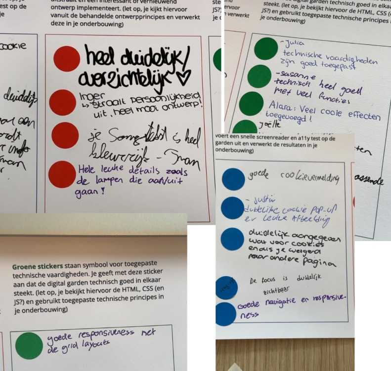
handschrift in paarse pen is van mij

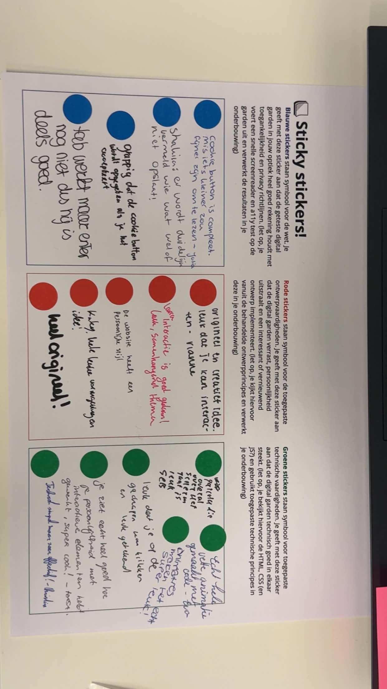
feedback van anderen op mijn website. Het zijn nog kleine verbeterpunten en ik hoop ze aan te passen voor de deadline.

### Webby forumlier

Voor het laatst heb ik de webby formulier ingevuld met een duo.

.jpg>)
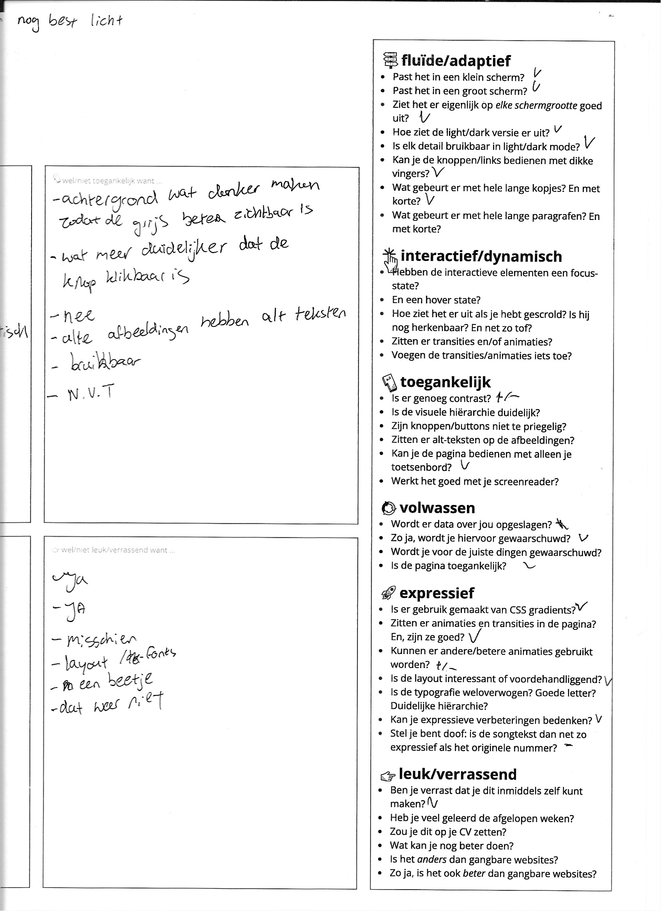
Er zijn nog paar kleine verbterpunten zoals de achtergrond die bij de dark mode een beetje donkerder kan, ook in het algemeen kan de achtergrond wat donkerder zodat de grijze trinkets beter zichtbaar zijn. Ook is het dat de knop niet helemaal duidelijk is als die klikbaar is.

Mijn learning log was nog incompleet dus heb ik de learning log form niet ingevult en zit ik alles momenteel bij te werken.

### Mini reflectie

Ik vond dit blok zeer uitdagend maar ook heel leuk omdat we zelf het onderwerp mochten kiezen. Hoewel ik veel tijd heb besteed aan het tekenen van mijn assests, ben ik ook best blij met mijn code. Ik had een flinke achterstand en moest veel dingen inhalen maar door de hulp van docenten en de feedback van anderen kwam ik nog best ver. Er missen inderdaad nog wat dingen, maar als ik meer tijd zou ik sowieso de responsiveness fixen, meer animaties gebruiken zoals in deze codepens (https://codepen.io/tianaxu976/pen/ExWqJao, https://codepen.io/editor/Ma5a/pen/01a15ac6-b828-7b78-83ed-9f698d025b39), meer interactie en nog het inkleuren van de trinkets. Ik heb veel geleerd over coderen en zou zeker in de toekomst nog iets doen met frontend design, maar ik zou dan wel meer tijd nodig hebben om een goede basis kennis op te bouwen. Ook hoop ik in de volgende blokken bij te blijven met de stof, want ik vind het wel nog jammer dat ik weinig heb gedaan met mijn songtekst omdat ik achterliep met mijn site. Daarnaast moet ik ook goed mijn proces bijhouden en dingen niet achteraf loggen.

